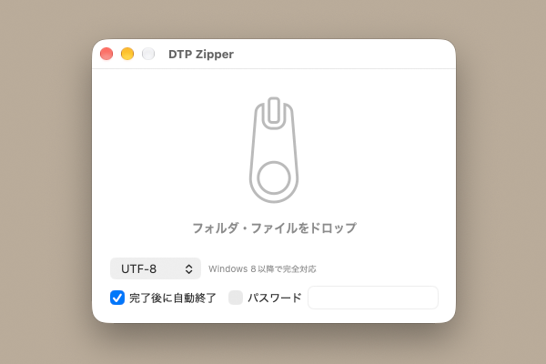

# DTP Zipper

macOS用デスクトップアプリ

## 用途

Macで作ったZIPファイルをWindowsで解凍すると、ファイル名が文字化けすることがあります。DTP Zipperは、WindowsでもMacでも文字化けしないようにZIPファイルを作るユーティリティアプリです。

- Windowsでは不要な「__MACOSX」フォルダを作りません。
- DTPではリンクファイルを扱うので、リンク切れを防ぐためファイル名を自動で変更しません。
- 解凍すると別の文字になったり、正しく解凍できなかったりするおそれがある名前は、圧縮せずに知らせます。
- 元のファイルやフォルダには一切手を加えません。

## 使い方

1. フォルダまたはファイルを、DTP Zipperのウインドウ、またはアプリのアイコンにドラッグ＆ドロップします。
2. DTP Zipperがすべての名前をチェックします。
	- 問題がなければそのまま圧縮します。ドロップした項目と同じフォルダにZIPファイルができます。
	- 問題があれば「名前のチェック」ウインドウが開きます。Finderで名前を直して「再チェック」をクリックします。

詳細は、DTP Zipperのヘルプメニュー「DTP Zipper ヘルプ」を選択してください。

## 動作環境

macOS 13.5 Ventura以降（Universal Binary）

## ライセンス

This project is licensed under the MIT License - see the [LICENSE](LICENSE) file for details.
